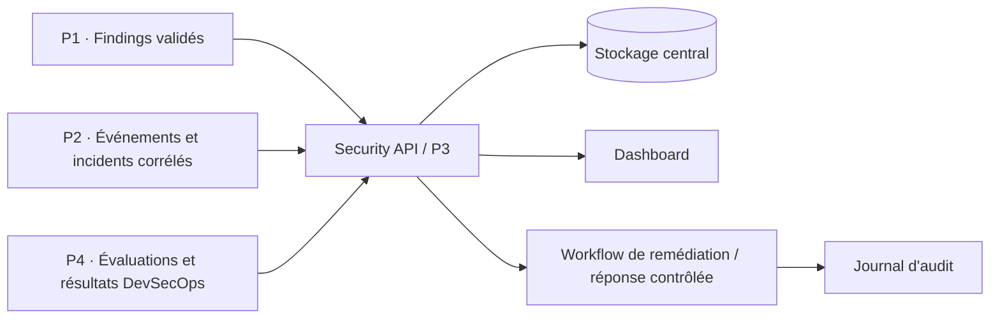

# Enterprise Web Security & Threat Response Platform

> **État du dépôt : fondations / scaffolding.** Ce dépôt définit l'architecture initiale, les contrats d'intégration, les règles de contribution et leur validation. Il ne prétend pas encore implémenter une plateforme opérationnelle.

Plateforme centralisée destinée à inventorier, évaluer et protéger plusieurs applications web d'une entreprise déjà en production. Elle relie les évaluations offensives, la détection défensive, la gestion des vulnérabilités et la réponse aux incidents, ainsi que les contrôles DevSecOps.

## Objectifs

- Centraliser les actifs, les findings, les événements, les incidents, les remédiations et les demandes d'action.
- Utiliser des contrats versionnés afin que les quatre modules puissent être développés en parallèle.
- Conserver la provenance, l'horodatage, la confiance et les références de preuves pour les décisions de sécurité.
- Prioriser les risques à partir de la sévérité technique et du contexte métier, sans confondre score interne et CVSS.
- Intégrer les outils existants — notamment Wazuh et Suricata — au lieu de prétendre les remplacer.
- Protéger l'API, les preuves, les secrets et les frontières entre tenants.

## Modèle de travail

| Équipe | Responsabilité | Répertoire principal |
|---|---|---|
| **P1 — Offensive Security** | Périmètre autorisé, pentest, validation et retest des vulnérabilités, preuves expurgées | `modules/p1-offensive/` |
| **P2 — Detection Engineering & AI** | Connecteurs Wazuh/Suricata, normalisation, détection, corrélation, playbooks et RAG sécurisé | `modules/p2-detection/` |
| **P3 — Platform Backend & Response** | Security API, identité/RBAC, isolation des tenants, findings, incidents, remédiations, orchestration et audit | `backend/` et `modules/p3-platform/` |
| **P4 — DevSecOps & AppSec Assurance** | CI/CD, SAST/SCA/secrets, scans externes autorisés, modèle de risque, threat modeling et assurance de plateforme | `modules/p4-assurance/` et `.github/` |

Les contrats partagés sont dans `contracts/`. La documentation d'architecture et de sécurité est dans `docs/`.

## Flux cible



## Architecture de départ

Le dépôt est un **monorepo** pour faciliter le travail d'équipe et le partage des contrats. Le choix définitif entre monolithe modulaire et services séparés doit être accepté dans un ADR avant le déploiement.

```text
.
├── .github/                 # CI, modèles d'issues et de pull requests
├── backend/                 # Plan de contrôle et Security API (propriétaire : P3)
├── contracts/               # OpenAPI, JSON Schema et fixtures contractuelles
├── database/                # Schémas et migrations partagés
├── deploy/                  # Déploiement local/démonstration (à ajouter avec les services)
├── docs/                    # Architecture, ADR, sécurité, runbooks et roadmap
├── frontend/                # Dashboard web
├── integrations/            # Adaptateurs vers les outils existants
├── modules/
│   ├── p1-offensive/        # Évaluations et export de findings
│   ├── p2-detection/        # Collecte, détection, corrélation, playbooks, RAG
│   ├── p3-platform/         # Logique métier du plan de contrôle
│   └── p4-assurance/        # Orchestrateur de scans et assurance DevSecOps
├── scripts/                # Validation locale et utilitaires de développement
└── tests/                   # Tests d'intégration et de contrats
```

## Contrats d'intégration

Les premières versions des schémas sont dans `contracts/json-schema/`, et leurs exemples fictifs dans `contracts/examples/` :

- `asset.schema.json`
- `finding.schema.json`
- `security-event.schema.json`
- `incident.schema.json`
- `remediation.schema.json`
- `action-request.schema.json`

Règles de base :

1. Toute modification incompatible exige une discussion, une mise à jour de version et une migration planifiée.
2. Les modules communiquent par API ou événements documentés ; ils ne modifient pas directement les tables privées d'un autre module.
3. Toute donnée doit inclure une provenance suffisante pour comprendre qui l'a créée et à partir de quelle source.
4. Une corrélation est une hypothèse contextualisée, pas une preuve automatique de compromission.
5. Une action de confinement ou de blocage en production nécessite un périmètre explicite, une approbation selon la politique, une idempotence et une trace d'audit.

## Démarrage local — validation des contrats

Prérequis : Git et Python 3.11 ou plus récent.

```powershell
# À exécuter depuis la racine du dépôt
py -3 -m venv .venv
.\.venv\Scripts\Activate.ps1
python -m pip install --upgrade pip
python -m pip install -r requirements-dev.txt
python scripts/validate_contracts.py
```

Le workflow GitHub Actions `.github/workflows/contract-validation.yml` exécute la même validation lors des pushes et pull requests.

## Sécurité et périmètre

- Créez le dépôt **privé** pendant le développement et l'intégration.
- Ne commitez jamais de token, mot de passe, clé privée, cookie de session, export de logs sensibles, PCAP, HAR ou preuve non expurgée.
- Les domaines `.example` des fixtures sont fictifs et ne constituent aucune autorisation de test.
- Aucun scan actif ne doit partir sans autorisation écrite, périmètre validé, exclusions, limite de débit et fenêtre d'exécution.
- Les exemples ne doivent jamais être utilisés comme données d'autorisation pour une cible réelle.
- N'activez pas de réponse destructive automatique sur la seule sortie d'un LLM ou d'une règle non validée.

Lire [SECURITY.md](SECURITY.md), [la politique de tests autorisés](docs/security/authorized-testing.md) et [le modèle de menace](docs/security/threat-model.md).

## Roadmap de haut niveau

Les jalons de 12 semaines sont proposés dans [`docs/roadmap.md`](docs/roadmap.md). Le premier jalon consiste à valider les contrats de données, les responsables de répertoires et les critères de sécurité avant de multiplier les implémentations.

## Références de travail

- [OWASP Web Security Testing Guide](https://owasp.org/www-project-web-security-testing-guide/)
- [OWASP ASVS](https://owasp.org/www-project-application-security-verification-standard/)
- [FIRST CVSS v4.0](https://www.first.org/cvss/v4.0/)
- [MITRE ATT&CK](https://attack.mitre.org/)
- [Wazuh documentation](https://documentation.wazuh.com/current/)
- [Suricata documentation](https://docs.suricata.io/)
- [NIST SP 800-61 Rev. 3](https://csrc.nist.gov/pubs/sp/800/61/r3/final)
