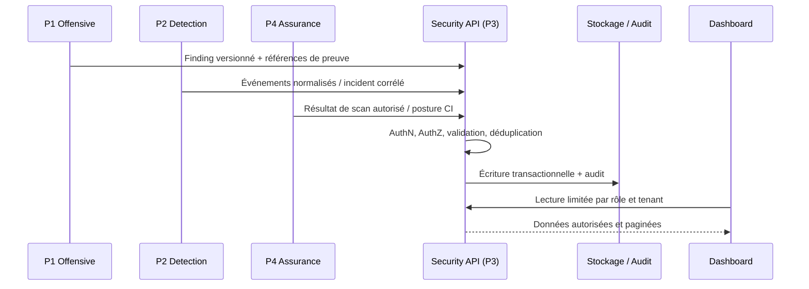

# Vue d'ensemble de l'architecture

## Principes

1. **Contrats avant intégration** : le JSON Schema et OpenAPI constituent la frontière de données entre modules.
2. **Plan de contrôle centralisé** : P3 possède l'API, l'autorisation, les workflows métier et l'audit.
3. **Intégration, pas réimplémentation** : Wazuh, Suricata et les outils de scan restent les moteurs spécialisés ; les modules développent les adaptateurs, enrichissements et workflows spécifiques.
4. **Preuves séparées** : les charges utiles sensibles restent dans un stockage protégé ; les événements métier contiennent des références d'évidence et des empreintes quand cela est utile.
5. **Sécurité par défaut** : moindre privilège, isolation tenant/actif, limites de débit, validations de schémas et refus par défaut pour les actions.
6. **Dégradations explicites** : chaque connecteur doit exposer son état, son dernier succès, les erreurs et les périodes de perte de visibilité.

## Flux de données

## Frontières de confiance

- Navigateurs et utilisateurs → frontend : jamais considérés comme fiables.
- Frontend → Security API : authentification et autorisation à refaire côté serveur.
- Connecteurs → ingestion API : identité de service, validation de schéma, quotas et provenance.
- Workers → outils externes : comptes aux privilèges minimaux, périmètres explicitement autorisés.
- LLM/RAG → système : le modèle peut proposer et expliquer ; il n'autorise pas ni n'exécute seul les actions sensibles.
- Stockage de preuves → utilisateurs : contrôle d'accès distinct de celui des métadonnées d'incident.

## Technologie

Go, PostgreSQL, un dashboard web TypeScript et des workers/connecteurs sont des choix de départ possibles. Les versions et choix définitifs doivent être inscrits dans un ADR avant d'ajouter la chaîne de build complète.
